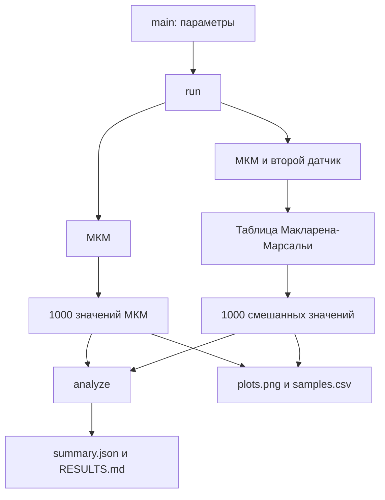
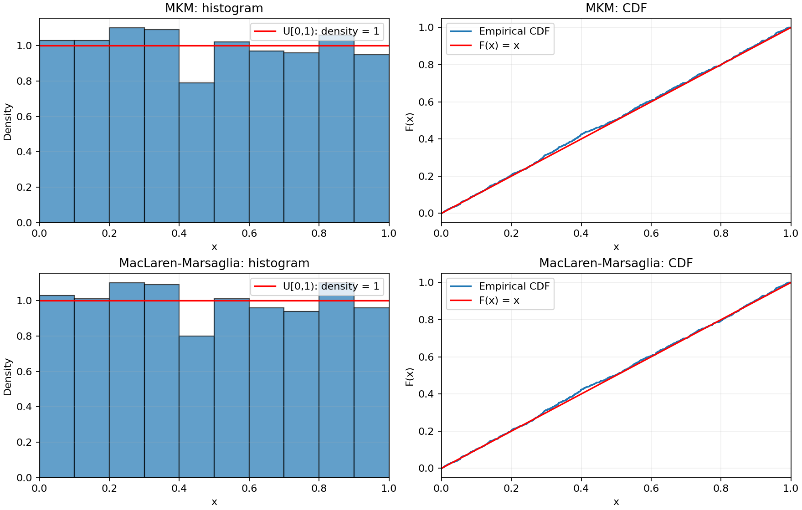

# Отчёт по лабораторной работе № 1

**Дисциплина:** математическое моделирование  
**Тема:** моделирование базовой случайной величины  
**Выполнил:** Кошель Александр Ростиславович, 3 курс, группа 12  
**Вариант:** 10  
**Год:** 2026

## 1. Цель и постановка

Изучить способы получения псевдослучайных чисел с равномерным распределением на [0,1), реализовать мультипликативный конгруэнтный метод (МКМ) и метод Макларена — Марсальи, получить по 1000 значений и исследовать согласие с теоретическим распределением с помощью критериев Колмогорова и Пирсона.

Постановка восстановлена по реализации и сохранённому автоматическому отчёту; оригинальный бинарный DOC непосредственно не прочитан.

| Параметр | Значение |
|---|---:|
| Начальное состояние a₀ | 16807 |
| Множитель β | 16807 |
| Модуль M | 2147483648 |
| Размер таблицы K | 64 |
| Объём каждой выборки n | 1000 |
| Уровень значимости α | 0.05 |
| Число интервалов | 10 |
| Seed второго датчика | 2026 |

## 2. Математические основы

Для U[0,1) плотность равна единице на интервале, F(x)=x внутри интервала, E[X]=1/2, Var(X)=1/12. Случайные числа моделируются детерминированными генераторами; seed обеспечивает воспроизводимость, но сам по себе не гарантирует качество.

МКМ задаётся рекуррентной формулой:

$$a_i=(16807a_{i-1})\bmod 2147483648,\qquad x_i=a_i/2147483648.$$

Например, a₁=16807²=282475249, x₁=282475249/2147483648≈0.13153779. Нормирование обеспечивает принадлежность [0,1).

Для смешанного метода заполняется таблица из 64 чисел МКМ. На шаге выбирается j=⌊64y⌋, где y получено вторым датчиком, выдаётся T[j], затем ячейка заменяется очередным значением МКМ. Для 1000 результатов используется 1064 значения источника. Начальное состояние МКМ для каждого эксперимента устанавливается заново.

## 3. Программная реализация

Язык Python; SciPy 1.15.2 и Matplotlib 3.10.1 согласно requirements.txt. Стандартные модули обеспечивают генерацию второго потока, вычисление среднего и дисперсии, интерфейс CLI и экспорт данных. Backend Agg позволяет сохранять графики без открывания окна.

Точка входа main разбирает variant, selector-seed, out. run создаёт два генератора и выборки; analyze вычисляет статистики; plot_samples формирует визуализацию; save_report создаёт краткий автоматический отчёт.



Функции multiplicative_congruential и maclaren_marsaglia используют yield, то есть сохраняют внутреннее состояние между вызовами next. Функция take материализует выборку. Подробное устройство функций приведено в [SKILL.md](SKILL.md).

## 4. Статистическая методика

H₀: распределение соответствует U[0,1), H₁: отличается. Используется α=0.05 для каждого теста отдельно.

### 4.1. Колмогоров

Для упорядоченных значений вычисляются D⁺=max(i/n−x₍ᵢ₎), D⁻=max(x₍ᵢ₎−(i−1)/n), D=max(D⁺,D⁻). Критическая граница для n=1000 по scipy.stats.kstwo.ppf равна 0.04277650046. p-value определяется функцией sf. При p<0.05 гипотеза отклоняется.

### 4.2. Пирсон

Интервал разделяется на десять частей шириной 0.1. Вероятность каждой части равна 0.1, ожидаемая частота 100. Статистика χ²=Σ(Oⱼ−100)²/100. Число степеней свободы 9; параметры распределения не оцениваются. Критическая граница равна 16.91897760. Ожидаемая частота 100 удовлетворяет условию не менее 5.

## 5. Результаты вычислительного эксперимента

Числа приведены из сохранённых [summary.json](results/summary.json) и [RESULTS.md](results/RESULTS.md); повторное выполнение программы при подготовке данного отчёта не проводилось.

| Характеристика | МКМ | Макларен — Марсалья |
|---|---:|---:|
| n | 1000 | 1000 |
| Среднее | 0.49327240 | 0.49500622 |
| Несмещённая дисперсия | 0.08305936 | 0.08341340 |
| Минимум | 0.00136756 | 0.00136756 |
| Максимум | 0.99259477 | 0.99259477 |
| D⁺ | 0.02572530 | 0.02372530 |
| D⁻ | 0.00480858 | 0.00784767 |
| D | 0.02572530 | 0.02372530 |
| √nD | 0.81350549 | 0.75025993 |
| p Колмогорова | 0.514011 | 0.617985 |
| χ² | 7.3 | 7.6 |
| p Пирсона | 0.605916 | 0.574903 |

Абсолютное отклонение среднего от 0.5: 0.00672760 и 0.00499378 соответственно. Абсолютное отклонение дисперсии от 1/12: 0.00027397 и 0.00008006 соответственно.

### 5.1. Частотный анализ

| Интервал | МКМ | Макларен — Марсалья | Ожидаемая частота |
|---|---:|---:|---:|
| [0.0;0.1) | 103 | 103 | 100 |
| [0.1;0.2) | 103 | 101 | 100 |
| [0.2;0.3) | 110 | 110 | 100 |
| [0.3;0.4) | 109 | 109 | 100 |
| [0.4;0.5) | 79 | 80 | 100 |
| [0.5;0.6) | 102 | 101 | 100 |
| [0.6;0.7) | 97 | 96 | 100 |
| [0.7;0.8) | 96 | 94 | 100 |
| [0.8;0.9) | 106 | 110 | 100 |
| [0.9;1.0) | 95 | 96 | 100 |
| Итого | 1000 | 1000 | 1000 |

Подстановка в статистику Пирсона для МКМ даёт (9+9+100+81+441+4+9+16+36+25)/100=7.3. Для смешанного метода (9+1+100+81+400+1+16+36+100+16)/100=7.6. Наибольший вклад в обоих случаях вносит интервал [0.4;0.5).

### 5.2. Графический анализ



Рисунок 1 — графики, сохранённые программой. Левая колонка показывает нормированные гистограммы; теоретическая плотность равна 1. Правая колонка сравнивает ЭФР с диагональю F(x)=x. По сохранённым числам высота пятого столбца равна 0.79 и 0.80, а максимальные отклонения ЭФР составляют около 0.026 и 0.024. Изображение подключено из репозитория, отдельно визуально в текущем сеансе не проверялось.

### 5.3. Решения

| Метод | Критерий | Сравнение | Решение |
|---|---|---|---|
| МКМ | Колмогоров | 0.02572530 < 0.04277650 | H₀ не отклоняется |
| МКМ | Пирсон | 7.3 < 16.918978 | H₀ не отклоняется |
| Макларен — Марсалья | Колмогоров | 0.02372530 < 0.04277650 | H₀ не отклоняется |
| Макларен — Марсалья | Пирсон | 7.6 < 16.918978 | H₀ не отклоняется |

Все четыре p-value больше 0.05. Смешанный метод имеет меньший D, но несколько больший χ². Однозначное превосходство одного метода не установлено.

## 6. Контроль корректности и воспроизводимость

По сохранённым данным размеры выборок равны 1000, минимумы и максимумы лежат в [0,1), суммы частот равны 1000, решения согласуются с критическими границами. Формулы χ² проверены подстановкой частот. В коде предусмотрены проверки диапазона параметров МКМ, положительного размера таблицы, диапазона выборки и минимальной ожидаемой частоты.

Для дополнительного контроля выполнить из корня проекта:

```powershell
cd lab-01
py -m venv .venv
.\.venv\Scripts\python.exe -m pip install -r requirements.txt
.\.venv\Scripts\python.exe lab1.py --variant 10 --selector-seed 2026 --out results-check
```

Сравнить summary.json с сохранённым результатом, проверить число строк CSV (1001 с заголовком), наличие PNG и отчёта. Изменение seed второго датчика не меняет выборку МКМ, но обычно меняет смешанную выборку. Это рекомендуемые проверки, а не заявление об их фактическом выполнении.

## 7. Вывод

Реализованы два алгоритма моделирования БСВ. По сохранённому эксперименту каждый сформировал 1000 чисел, описательные характеристики близки к теоретическим, критерии согласия при α=0.05 не обнаружили статистически значимых отклонений от U[0,1). Результат относится к одномерному распределению изученных выборок: он не доказывает независимость, отсутствие периодичности или абсолютную случайность. Для более строгого сопоставления генераторов необходимы дополнительные выборки и тесты зависимостей.

## 8. Приложения и источники

- [Исходный код](lab1.py) — полный листинг.
- [CSV](results/samples.csv) — все полученные значения.
- [JSON](results/summary.json) — точные статистики.
- [Теоретический материал](../materials/lab-01-theory.md).
- [Документация SciPy: kstwo](https://docs.scipy.org/doc/scipy/reference/generated/scipy.stats.kstwo.html).
- [Документация SciPy: chisquare](https://docs.scipy.org/doc/scipy/reference/generated/scipy.stats.chisquare.html).
- [MacLaren, Marsaglia, Uniform Random Number Generators (1965)](https://www.osti.gov/pages/servlets/purl/4578911).
